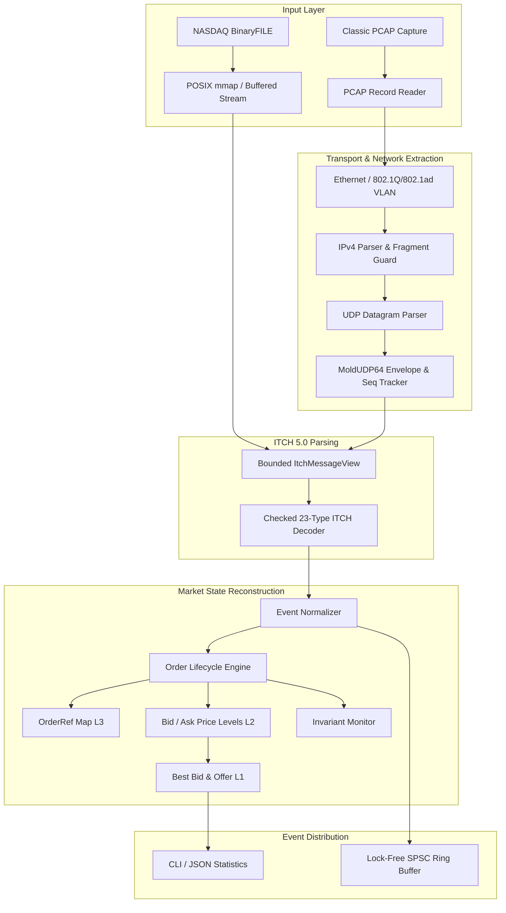

# FastITCH (QD-02)

[](https://en.cppreference.com/w/cpp/20)
[](https://cmake.org)
[](LICENSE)
[]()
[]()

> High-throughput, bounds-checked NASDAQ TotalView-ITCH 5.0 market-data ingestion and order-book reconstruction engine in modern C++20.

---

## 1. Executive Summary

**FastITCH** is a standalone, deterministic market-data feed handler and order-book reconstruction engine. It bridges raw binary exchange captures (historical NASDAQ BinaryFILE or classic PCAP carrying MoldUDP64 over UDP) to queryable Level 1 Top-of-Book (BBO) and normalized market event streams.

FastITCH is built with zero-compromise safety:
- **Zero Struct Overlays / UB:** Rejects raw `#pragma pack(1)` struct casting on unaligned buffers in favor of non-owning, bounds-checked `std::span<const std::byte>` readers with compiler byte-swap intrinsics.
- **Accurate 48-bit Nanosecond Timestamps:** Reconstructs exact 6-byte nanosecond-since-midnight timestamps without reading out-of-bounds bytes.
- **Fixed-Point Price Precision:** Prices are stored as unsigned 32-bit tick integers (4 implied decimals); floating-point conversions are deferred strictly to presentation boundaries.
- **True Level 3 (L3) Order Lifecycle Engine:** Aggregates individual resting order references into price levels for 65,536 stock locates, deriving the correct Best Bid and Offer (BBO) across order additions, partial/full executions, cancellations, and replacements.
- **Session Continuity & Integrity Enforcement:** Distinguishes complete vs truncated streams and detects MoldUDP64 sequence gaps, marking corrupt states as untrusted.

---

## 2. Pipeline Architecture



---

## 3. Official ITCH 5.0 Message Support

FastITCH maintains a versioned message registry covering **all 23 official message types** specified in NASDAQ TotalView-ITCH 5.0:

| Tag | Message Name | Wire Size | Category | Order Book Impact |
|:---:|:---|:---:|:---|:---|
| `S` | System Event | 12 bytes | Session / Status | Metadata only |
| `R` | Stock Directory | 39 bytes | Symbol Directory | Maps StockLocate (0–65535) to ticker |
| `H` | Stock Trading Action | 25 bytes | Trading Status | Metadata only |
| `Y` | Reg SHO Short Sale | 20 bytes | Regulatory | Metadata only |
| `L` | Market Participant Position | 26 bytes | MPID State | Metadata only |
| `V` | MWCB Decline Level | 35 bytes | Circuit Breaker | Metadata only |
| `W` | MWCB Status | 12 bytes | Circuit Breaker | Metadata only |
| `K` | IPO Quoting Period | 28 bytes | IPO Quotation | Metadata only |
| `J` | LULD Auction Collar | 35 bytes | Auction Collar | Metadata only |
| `h` | Operational Halt | 21 bytes | Market Halt | Metadata only |
| `A` | **Add Order (No MPID)** | 36 bytes | Order Ingestion | **Creates resting order (L3) & updates bid/ask levels (L2)** |
| `F` | **Add Order (With MPID)** | 40 bytes | Order Ingestion | **Creates resting order with MPID attribution** |
| `E` | **Order Executed** | 31 bytes | Order Execution | **Reduces resting order; removes level at zero** |
| `C` | **Order Executed With Price** | 36 bytes | Order Execution | **Reduces resting order; records execution price** |
| `X` | **Order Cancel** | 23 bytes | Cancellation | **Reduces resting order quantity** |
| `D` | **Order Delete** | 19 bytes | Cancellation | **Deletes resting order; erases empty level** |
| `U` | **Order Replace** | 35 bytes | Replacement | **Atomically cancels old order, creates new ID with inherited side/symbol** |
| `P` | Non-Cross Trade | 44 bytes | Trade Print | Normalizes trade; **does NOT alter resting book** |
| `Q` | Cross Trade | 40 bytes | Cross Summary | Normalizes auction; **does NOT alter resting book** |
| `B` | Broken Trade | 19 bytes | Trade Correction | Normalizes correction; **does NOT alter resting book** |
| `I` | NOII | 50 bytes | Imbalance | Auction imbalance metadata only |
| `N` | Retail Price Improvement | 20 bytes | Retail Interest | Retail interest flag only |
| `O` | Direct Listing Capital Raise | 48 bytes | Price Discovery | Auction price discovery only |

---

## 4. Measured Performance Benchmarks

All metrics below were measured on an **AMD Ryzen 9 8940HX (16 Cores, 32 Threads)** under **Linux 6.18.33.1 (WSL2 Ubuntu 22.04 LTS)** compiled with **GCC 11.4.0 (`-O3 -std=c++20`)** across 5 measured trials (with warm-up) on 500,000 synthetic ITCH 5.0 messages:

```
Benchmark Category                      Throughput   Latency (med)        MB/sec      Std Dev
==============================================================================================
1. ITCH Decode-Only                      18.57 M/s         53.9 ns      566.7 MB/s        0.6 ms
2. BinaryFILE Framing + Decode           15.94 M/s         62.7 ns      516.8 MB/s        0.6 ms
3. Order Book Apply (L3->L1)             17.55 M/s         57.0 ns      535.7 MB/s       19.6 ms
4. End-to-End Replay (BinaryFILE)         8.02 M/s        124.8 ns      259.9 MB/s        1.1 ms
==============================================================================================
```

> **Note on "Zero-Copy":** In FastITCH, zero-copy refers to memory-mapped file access (`mmap`) where the application does not eagerly copy entire multi-gigabyte files into intermediate application buffers, and packet decoders operate on non-owning spans of the memory-mapped virtual address pages. It does not imply the absence of OS kernel page faults on initial page access.

---

## 5. Quick Start & Build Instructions

### Prerequisites
- Modern C++20 compiler: GCC 11+ or Clang 13+
- CMake 3.20+
- Linux / POSIX environment (WSL2 supported)

### 1. Build
```bash
# Debug build with AddressSanitizer and UndefinedBehaviorSanitizer
cmake -B build_debug -DCMAKE_BUILD_TYPE=Debug -DENABLE_SANITIZERS=ON
cmake --build build_debug -j$(nproc)

# Release build with -O3 optimizations
cmake -B build_release -DCMAKE_BUILD_TYPE=Release
cmake --build build_release -j$(nproc)
```

### 2. Generate Synthetic Deterministic Fixtures
```bash
python3 tools/generate_fixtures.py fixtures
```

### 3. Run Test Suite
```bash
# Runs all 72 unit, integration, property, and fuzz tests
ctest --test-dir build_debug --output-on-failure
```

### 4. Run the Benchmarks
```bash
./build_release/fastitch_bench 500000
```

---

## 6. CLI Usage & Demonstration

```bash
# 1. Replay BinaryFILE with Top-of-Book (BBO) for AAPL
./build_release/fastitch --input fixtures/synthetic_session.bin --format binaryfile --symbol AAPL --summary

# 2. Replay MoldUDP64 PCAP capture
./build_release/fastitch --input fixtures/synthetic_moldudp64.pcap --format pcap --symbol AAPL --summary

# 3. Export machine-readable JSON execution statistics
./build_release/fastitch --input fixtures/synthetic_session.bin --symbol AAPL --stats-json results/run_stats.json

# 4. View all 23 official message catalogue definitions
./build_release/fastitch --list-message-types
```

### Sample CLI Output:
```text
================= FastITCH Replay Summary =================
Input File:         fixtures/synthetic_session.bin
Format:             binaryfile
Total Messages:     12
Active Resting:     4
Elapsed Time:       8.31 ms
Throughput:         0.00 M msgs/sec
Session Status:     COMPLETE (Clean 0x0000 EOS)
Book Integrity:     VALID (Verified Invariants)

--- Top-of-Book (BBO) for AAPL ---
Bid: $150.0000 x 300 shares (1 orders)
Ask: $150.4000 x 250 shares (1 orders)
Spread:             $0.4000
===========================================================
```

---

## 7. Web Terminal & Visual Market Data Interface

In addition to the high-performance C++ CLI engine, FastITCH includes an **institutional-grade visual Web Terminal** located in `web/`.

### Key Features:
- **Level 2 Market Depth Ladder:** Live bid/ask price levels with proportional visual depth bars and real-time BBO spread calculation.
- **Level 3 Active Orders Explorer:** Queryable active resting order book displaying individual order reference numbers, remaining quantities, and MPID attribution.
- **Time & Sales Live Event Tape:** Color-coded streaming ITCH 5.0 event feed (`A`, `F`, `E`, `C`, `X`, `D`, `U`, `P`, `Q`).
- **Wire Packet Dissector:** Click on any event to inspect color-coded raw wire hex bytes synchronized with parsed field schemas.
- **MoldUDP64 Sequence & Gap Monitor:** Real-time sequence continuity tracking that alerts and invalidates the book whenever sequence gaps or corrupt packets are detected.
- **Zero-Dependency Standalone Mode:** Can be opened directly in any modern browser via `file://` or served through the local Python web server.

### Launching the Web Terminal:

```bash
# 1. Start the local terminal server
python3 tools/web_server.py 8080

# 2. Open in your browser:
# http://localhost:8080/
```

Alternatively, open `web/index.html` directly in any web browser without starting a server.

---

## 8. Supported vs. Unsupported Scope (v1)

| Feature | Status | Notes |
|---|:---:|---|
| Historical BinaryFILE Ingestion | **Supported** | Memory-mapped (`mmap`) & buffered stream fallback |
| Classic PCAP (Ethernet / IPv4 / UDP) | **Supported** | Handles 0, 1, or 2 802.1Q/802.1ad VLAN tags |
| MoldUDP64 Downstream | **Supported** | 20-byte header, sequence tracking, heartbeat & EOS |
| Sequence Gap Detection | **Supported** | Marks book state untrusted / invalid on gaps |
| Level 3 Order Book Reconstruction | **Supported** | Active order tracking, price level aggregation, BBO |
| Lock-free SPSC Ring Buffer | **Supported** | Cache-line aligned, acquire-release memory ordering |
| Visual Market Data Web Terminal | **Supported** | Standalone HTML5/JS L2/L3 terminal with wire dissector |
| PCAPNG / IPv6 / TCP / SoupBinTCP | Unsupported | Out of scope for v1 |
| Live Multicast Socket Ingestion | Unsupported | Replay from offline PCAP or BinaryFILE captures |
| MoldUDP64 Retransmission Request | Unsupported | Passive offline replay; gaps flag book as invalid |

---

## 9. License

FastITCH is released under the MIT License. See [LICENSE](LICENSE) for details.
