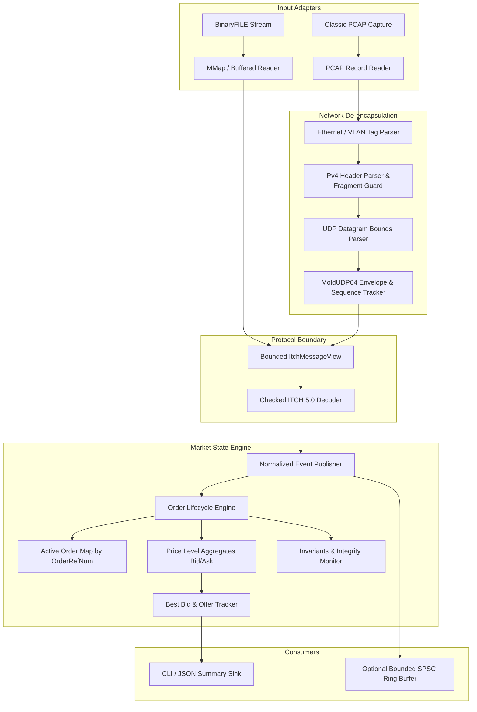

# FastITCH Architecture Specification

## 1. System Mission & Boundary
FastITCH (QD-02) is a standalone, deterministic C++20 market-data feed handler and order-book reconstruction engine for NASDAQ TotalView-ITCH 5.0. It ingests historical BinaryFILE streams or raw network PCAP captures containing MoldUDP64 packets, validates protocol framing, decodes ITCH messages safely without undefined behavior, maintains a reconstructed order-level book (L3) with price-level aggregation (L2) to derive the Top-of-Book (BBO/L1), and emits normalized market events.

FastITCH deliberately focuses on the byte-stream-to-market-state pipeline. It contains no trading strategies, execution gateways, or generic database abstractions.

## 2. Component Responsibilities & Invariants

### 2.1 Safe Byte Primitives (`include/fastitch/bytes.hpp`)
- Provides bounds-checked byte reading helpers (`read_u8`, `read_be_u16`, `read_be_u32`, `read_be_u64`, `read_be_u48`).
- Uses compiler byte-swap intrinsics (`__builtin_bswap16/32/64`) guarded by `std::endian::native == std::endian::little`.
- Reconstructs 6-byte nanosecond timestamps into 64-bit unsigned integers without buffer overrun.
- Extracts right-padded ASCII alpha fields safely as `std::string_view` without null-termination assumptions.

### 2.2 Error Model (`include/fastitch/result.hpp`)
- Bounded `Result<T, ParseError>` template avoiding C++ exception overhead on data paths.
- Carries detailed diagnostic context: source layer, byte offset, packet index, message sequence, and specific failure reason.

### 2.3 BinaryFILE Source (`include/fastitch/binaryfile_source.hpp`)
- Replays decompressed NASDAQ historical files.
- Records are framed as `uint16_t length (big-endian) + ITCH payload`.
- Terminal marker is a 2-byte `0x0000` record. Distinguishes clean termination, midstream zero, truncated prefixes, truncated payloads, and trailing unexplained bytes.

### 2.4 PCAP & MoldUDP64 Source (`include/fastitch/pcap_source.hpp`, `moldudp64.hpp`, `ethernet_ipv4_udp.hpp`)
- Classic PCAP parser detecting little-endian (`0xa1b2c3d4`) and big-endian (`0xd4c3b2a1`) magic, and microsecond/nanosecond timestamps.
- Ethernet parser with single and double (802.1Q/802.1ad) VLAN support.
- IPv4 parser respecting variable IHL; drops/flags fragmented packets before MoldUDP64 processing.
- UDP parser validating datagram length bounds.
- MoldUDP64 parser handling 20-byte downstream header (session, sequence number, message count). Handles count=0 (heartbeat) and count=0xFFFF (end of session).
- Sequence tracker monitoring continuity: any detected sequence gap marks the reconstructed book state untrusted.

### 2.5 ITCH 5.0 Decoder (`include/fastitch/itch_decoder.hpp`, `protocol.hpp`)
- Versioned catalogue of all 23 official ITCH 5.0 message types.
- Exact payload length enforcement. Recognized messages with incorrect length are rejected immediately.
- Configurable unknown type policy: strict rejection or permissive whole-payload skip with counter increment.

### 2.6 Order Lifecycle Engine (`include/fastitch/order_book.hpp`)
- Maintains active orders in a hash map keyed by 64-bit `Order Reference Number`.
- Aggregates price levels per `StockLocate` code (0–65,535): descending price map for Bids, ascending price map for Asks.
- Handled lifecycle events:
  - `A` / `F`: Add Order (no MPID / with MPID).
  - `E` / `C`: Order Executed (reduce order and price level; remove order when shares reach 0).
  - `X`: Order Cancel (reduce order and price level).
  - `D`: Order Delete (remove order and price level completely).
  - `U`: Order Replace (atomically remove old order and create new order with new ID, retaining side and symbol/locate).
- Non-mutating events: `P` (Trade non-cross), `Q` (Cross Trade), `B` (Broken Trade), and administrative types emit normalized events without mutating the resting displayed book.
- Atomic state transitions: invalid events fail completely without partial state alteration.

### 2.7 Buffer Lifetime Contract
- `ItchMessageView` holds a non-owning `std::span<const std::byte>`.
- The backing buffer (memory-mapped file or stream chunk) is guaranteed valid for the duration of the message decode and event processing step. No pointers outlive the source wrapper.
